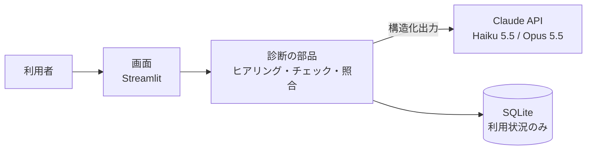

# AI-BIC（AI Business Improvement Consultant）

**業務担当者にAIがヒアリングし、業務の課題と改善案を「根拠つき」で整理するWebアプリ**です。

AIの回答をそのまま信じず、「AIが事実と言った根拠が、利用者の発言に本当にあるか」をプログラムで照合する仕組みを持っています。

> **公開URL：** https://ai-bic.streamlit.app/ （Streamlit Community Cloud。デモモードはどなたでもお試しいただけます）
> **開発の状況（2026-11-01）：** MVPの機能を実装し、自動テスト279件と、本物のAI（Claude API）による3つの業務シナリオでの品質評価を完了しました。

---

## 開発の背景

業務改善の現場では、「何となく面倒だが、どこが本当の問題か言葉にできない」「最初のヒアリングの質が担当者によってばらつく」「改善策がいきなり新しいシステムの導入になる」といったことが起こりがちです。

AI-BIC は、業務改善コンサルタントが行う**初回ヒアリングと課題の整理**を、AIの支援で誰でも同じ品質で行えるようにすることを目指しました。

## 解決したい業務課題

| 業務の現場で起きること | AI-BICでの解決方法 |
|---|---|
| 担当者が、業務の問題点を言葉にできない | 決められた6つの診断項目（目的・作業内容・時間・ツール・問題点・制約）に沿って、AIが1問ずつ質問して整理する |
| ヒアリングの質が、聞き手のスキルに左右される | 7つの評価観点（業務効率・標準化・自動化可能性・データ管理・人的ミス・属人化・システム連携）で、同じ基準で診断する |
| 事実と推測が混ざったまま、改善策が議論される | 課題を「事実」「推測」「要確認」に分けて表示し、根拠となった発言を引用する |
| 改善策が「システム導入ありき」になりやすい | ルールの見直し → 標準化 → 既存ツールの活用 → 自動化 → 新規システムの順に検討する |

※ 一般的な業務改善の現場を想定した課題です。特定の企業での調査や実測に基づくものではありません。

## 診断の流れ

1. **業務情報を入力**：部署・業務名・業務の概要・困っていること
2. **AIのヒアリングに回答**：最大5問。分かっていることは聞かず、あいまいな回答は確かめる
3. **資料を添付（任意）**：集計表や記録（CSV・テキスト・Excel）を、課題分析の根拠として使う
4. **診断結果を確認**：
   - **診断サマリー**：最も重要な課題と、最初に取り組むべきこと
   - **課題**：重要度・事実／推測の区別・根拠となった発言や資料
   - **改善案（最大3件）**：導入前後の比較（BEFORE／AFTER）、今週から始められる「最初の一歩」、推奨理由、リスク

## 工夫した点

### 1. AIの「もっともらしい誤り」を、プログラムで見つける
AIが「事実」とした課題は、根拠として引用した発言が、利用者の入力や添付資料の中に**一字一句**あるかを照合します。確認できない場合は「要確認」に格下げして表示します。

### 2. 「ルールで頼む」と「仕組みで守る」の二重の対策
AIへの指示（プロンプト）だけでは、ルールは必ずしも守られません。質問の回数、同じ質問の繰り返し、改善案の形式などは、プログラムが数えて確認し、違反があればAIを呼び直します。

### 3. 本物のAIで評価し、問題を見つけて直す
3つの架空の業務シナリオで本物のAIを使って評価し、見つかった問題（同じ質問の繰り返し、途中で止まる）を、**原因分析 → 対策 → 再測定**で解消しました（[テスト結果](docs/06_テスト結果.md)）。

### 4. 費用と安全への配慮
- モデルの使い分け：質問は速くて安いモデル（Claude Haiku 5.5）、分析と提案は高性能なモデル（Claude Opus 5.5）
- 1日の診断回数の上限と、API提供元の前払い残高（自動チャージなし）による二重の費用管理
- 業務内容は保存しない、APIキーをソースコードに含めない、入力欄を使った攻撃（プロンプトインジェクション・XSS）への対策

## デモ（APIキー不要）

トップ画面の「デモで試す」から、3つの架空の業務で、画面の流れを最後まで確認できます。

| シナリオ | 見られること |
|---|---|
| 月次売上集計（営業管理部） | AIが根拠のない「事実」を挙げたとき、プログラムが見抜いて「要確認」に格下げする |
| 修理依頼の受付・手配（お客様相談室） | あいまいな回答への確認質問、質問回数の上限、新規システムを安易に勧めない提案 |
| 交通費の精算・承認（総務部） | 分かっていることは聞かない（2問で終了）、「クラウドは使えない」という制約を守った提案、自動化の提案 |

※ デモでは、あらかじめ用意した固定の結果を表示します（画面に「デモモード」と常に表示されます）。

## 使用技術

| 役割 | 技術 | 選んだ理由 |
|---|---|---|
| 言語 | Python 3.15 | 業務の自動化やAIの活用で広く使われている |
| 画面 | Streamlit 1.66 | Pythonだけで画面を作れ、短期間で動くものを作れる |
| AI | Claude API（anthropic SDK 2.3） | 決まった形（JSON）で回答させる「構造化出力」に対応し、出力をプログラムで検証しやすい |
| データの形の定義 | Pydantic | AIの回答の項目・型・値の候補を定義し、想定外の値をはじける |
| 利用状況の記録 | SQLite | 追加のサーバーが不要 |
| 資料の読み込み | openpyxl | Excelファイルの読み込み |
| テスト | pytest | 本物のAIを偽物に差し替えるテストが書きやすい |

## システム構成



詳しくは [システム構成図](docs/07_システム構成図.md) を参照してください。

## 起動方法（Windows）

```powershell
# 1. 環境を作る（初回のみ）
python -m venv .venv
.\.venv\Scripts\python.exe -m pip install -r requirements-dev.txt

# 2. 起動する
.\.venv\Scripts\streamlit.exe run app.py
```

ブラウザで http://localhost:8501 が開きます。デモモードは、このまま使えます。

**AI診断を使う場合：** `.streamlit/secrets.toml.example` をコピーして `.streamlit/secrets.toml` を作り、Claude APIのキーとアクセス用パスワードを書いてください（このファイルはGitに含まれません）。

## テスト

```powershell
.\.venv\Scripts\python.exe -m pytest
```

| 種類 | 結果 |
|---|---|
| 自動テスト（単体・画面の結合） | **290件すべて成功**（約40〜50秒。本物のAIは使わず、料金はかからない） |
| 異常系 | 未入力・APIキー未設定・通信エラー・利用制限・想定外のAIの回答・途中終了 |
| AI品質評価（本物のAI） | 3シナリオすべて完了。「事実」とした課題の根拠はすべて入力に実在。新規システムの提案は0件 |
| 公開環境での手動確認 | デモ・パスワードの照合・AI診断・ファイルの添付が動作することを確認 |
| 費用（実測） | 1回の診断 約30円（見積もりは約24円。差の理由は[テスト結果](docs/06_テスト結果.md)に記載） |

テストの観点と結果の詳細は、[テスト仕様書](docs/05_テスト仕様書.md) と [テスト結果](docs/06_テスト結果.md) を参照してください。

## 開発の進め方と役割分担

要件定義 → 基本設計 → 詳細設計 → 実装 → テスト → AI品質評価の順に進め、各工程の成果物を docs/ に残しました。

| 担当 | 内容 |
|---|---|
| 開発者（本人） | 題材と目的の決定、要件・設計の判断と承認、**資料の添付機能の発案**、利用者としての操作と改善の指摘（改善案の具体性、画面デザイン）、AIの品質問題への対策方針の選択 |
| AI（Claude Code） | 文書の草案、プログラムとテストコードの作成、テストとAI品質評価の実行、問題の原因分析と対策案の提示 |

詳しくは [開発で学んだこと](docs/08_開発で学んだこと.md) を参照してください。

## 今後の拡張計画

| 計画 | 内容 |
|---|---|
| 品質の改善 | 評価で見つかった課題のうち、未解消の「業務概要に書かれた内容を質問することがある」への対応（質問を作るモデルの見直しなど） |
| 専門診断モジュール | 製造業向け（生産管理・在庫・品質など）、情報システム部門向け（ヘルプデスク・IT資産管理など）。診断項目は設定ファイルにあるため、ファイルの追加で拡張できる |
| 診断結果の活用 | 費用対効果の試算、As-Is／To-Be 業務フロー、改善ロードマップ、要件定義書のたたき台の作成 |
| 出力 | 診断結果のPDF・Excel出力 |

## ドキュメント

| 文書 | 内容 |
|---|---|
| [01 企画書](docs/01_企画書.md) | 背景・課題・対象ユーザー・MVPの範囲 |
| [02 要件定義書](docs/02_要件定義書.md) | 機能・非機能要件、決定事項（0.4版） |
| [03 基本設計書](docs/03_基本設計書.md) | 構成・モジュール分割・画面・AI連携（0.3版） |
| [04 詳細設計書](docs/04_詳細設計書.md) | データの形・プロンプトの方針・関数・設定値（0.10版） |
| [05 テスト仕様書](docs/05_テスト仕様書.md) | テストの観点と合格基準 |
| [06 テスト結果](docs/06_テスト結果.md) | 自動テストとAI品質評価の結果、問題と対策 |
| [07 システム構成図](docs/07_システム構成図.md) | 全体の構成・モジュール・処理の流れ・データの流れ |
| [08 開発で学んだこと](docs/08_開発で学んだこと.md) | 学び、役割分担、面接での説明の例 |

## データについて

デモ・テスト・サンプルファイルに登場する会社名・部署・業務の内容は、すべて架空のものです。
