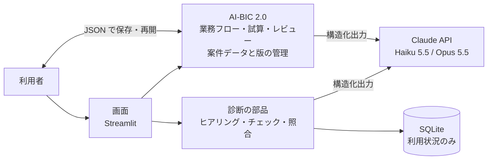

# AI-BIC（AI Business Improvement Consultant）

**現場の課題を可視化し、改善案の効果と実現可能性を検証する、AI業務改善アプリ**です。

業務担当者にAIがヒアリングして課題と改善案を「根拠つき」で整理したうえで（AI-BIC 1.0）、
**① 業務フローの可視化（現状と改善後の比較）、② 改善効果の試算（削減時間・回収期間）、③ 改善案の批判的なレビュー** で、
AIの提案を「理解し、数値で確かめ、鵜呑みにせずに評価できる」ようにしました（AI-BIC 2.0）。

AIの回答をそのまま信じず、根拠の引用が利用者の入力に本当にあるか、計算や判定が決まった基準に合っているかを、プログラムで確かめる仕組みを持っています。

> **公開URL：** https://yukon2051-ai-bic.hf.space/ （Hugging Face Spaces。デモモードはどなたでもお試しいただけます。しばらく利用がないと休止し、開いたときに自動で起動するため、表示まで少しお待ちいただくことがあります）
> 予備の公開先：https://ai-bic.streamlit.app/ （Streamlit Community Cloud。2026-11-04 に Hugging Face Spaces へ移行。理由は[テスト結果の「4. 公開環境での確認」](docs/06_テスト結果.md#4-公開環境での確認11で追加)）
> **開発の状況：** MVPの機能を実装し、本物のAI（Claude API）による3つの業務シナリオでの品質評価を完了しました（2026-11-01）。外部評価の指摘への対応（2026-11-03）のあと、**AI-BIC 2.0**（業務フロー・効果試算・改善案レビュー・ヒアリングの追加確認・保存と再開）を実装しました（2026-11-09）。
> **最新の検証結果**（実施日・コミット・環境・テスト件数）は、[テスト結果の「0. 最新の検証結果」](docs/06_テスト結果.md#0-最新の検証結果) の1か所にまとめています。

---

## 開発の背景

業務改善の現場では、「何となく面倒だが、どこが本当の問題か言葉にできない」「最初のヒアリングの質が担当者によってばらつく」「改善策がいきなり新しいシステムの導入になる」といったことが起こりがちです。

AI-BIC は、業務改善コンサルタントが行う**初回ヒアリングと課題の整理**を、AIの支援で誰でも同じ品質で行えるようにすることを目指しました。

## 解決したい業務課題

| 業務の現場で起きること | AI-BICでの解決方法 |
|---|---|
| 担当者が、業務の問題点を言葉にできない | 決められた6つの診断項目（目的・作業内容・時間・ツール・問題点・制約）に沿って、AIが1問ずつ質問して整理する |
| ヒアリングの質が、聞き手のスキルに左右される | 7つの評価観点（業務効率・標準化・自動化可能性・データ管理・人的ミス・属人化・システム連携）で、同じ基準で診断する |
| 事実と推測が混ざったまま、改善策が議論される | 課題を「本人の申告」「計算結果」「推測」「要確認」に分けて表示し、根拠となった発言と、そこから言えることを並べる |
| 改善策が「システム導入ありき」になりやすい | ルールの見直し → 標準化 → 既存ツールの活用 → 自動化 → 新規システムの順に検討する |

※ 一般的な業務改善の現場を想定した課題です。特定の企業での調査や実測に基づくものではありません。

## 診断の流れ（STEP 1〜6）

結果画面の上部に、STEP ごとの状態（✓完了・…作業中・○未着手・？要確認・↻要更新）と「次にすること」を表示します。

1. **ヒアリング**：業務情報を入力し、AIの質問に回答します。**基本5問**。そのあと、3つの機能に必要な情報が足りない場合だけ、理由を示して**最大3問の追加確認**を提案します（「このまま分析する」も選べます）。分からない点は「分からない」ボタンで答えられます。資料（CSV・テキスト・Excel）を添付すると、課題分析の根拠に使います
2. **診断結果**：最も重要な課題と最初の一手（診断サマリー）、根拠の区分つきの課題、改善案（最大3件）。情報が足りないまま分析した場合は、未確認事項と**仮定条件**を示します
3. **業務フロー（現状と改善後）**：ヒアリングから現状の業務フローを、改善案ごとに改善後の業務フローを作ります。図はズーム・パンでき、工程をクリックすると詳細を表示します。現状と改善後を同じ縮尺で並べて比べられ、表で工程や接続を直せます
4. **改善効果の試算**：作業時間・件数・人件費・削減率・費用から、年間削減時間・削減効果額・投資回収期間を**プログラムで計算**します。全改善案を1つの表で比べられ、悲観・標準・楽観のシナリオも見られます。業務フローの時間を試算に反映できます
5. **改善案チャレンジレビュー**：改善案を作ったAIとは別の指示文で、6つの観点から**批判的に評価**します。プログラムの検証で判定を上書きし、指摘ごとに「採用・保留・却下」を選んで、採用した指摘だけで改善案を作り直せます
6. **改善案の確定**：レビューを踏まえて改善案を確定します

診断レポート・試算・業務フローは Excel で、業務フロー図は画像（PNG）で出力できます。サーバーには保存しないため、**案件を JSON で保存**し、TOP画面から読み込んで再開できます。

## 工夫した点

### 1. AIの「もっともらしい誤り」を、プログラムで見つける
AIが「本人の申告」「計算結果」とした課題は、根拠として引用した発言が、利用者の入力や添付資料の中に**一字一句**あるかを照合します。さらに、引用のすぐ後が否定の言葉になっていないか（「ミスがあることはない」から「ミスがある」だけを切り取っていないか）、計算式に使った数値が入力に実在するかも確かめます。確認できない場合は、理由を添えて「要確認」に格下げして表示します。

「事実」ではなく「本人の申告」と呼ぶのは、発言にそう書かれていることと、それが客観的に正しいことは別だからです。

### 2. 「ルールで頼む」と「仕組みで守る」の二重の対策
AIへの指示（プロンプト）だけでは、ルールは必ずしも守られません。質問の回数、同じ質問の繰り返し、改善案の形式などは、プログラムが数えて確認し、違反があればAIを呼び直します。

### 3. 本物のAIで評価し、問題を見つけて直す
3つの架空の業務シナリオで本物のAIを使って評価し、見つかった問題（同じ質問の繰り返し、途中で止まる）を、**原因分析 → 対策 → 再測定**で解消しました（[テスト結果](docs/06_テスト結果.md)）。

### 4. AIの提案を「数値で確かめ、鵜呑みにしない」（AI-BIC 2.0）
- **可視化**：業務フローは工程と接続のデータとして持ち、図は表示のたびに作ります。分岐や差し戻しがあっても、作業時間は工程ごとに「時間×実施割合」を1回ずつ数え、二重に数えません
- **定量化**：試算の計算はAIにさせず、プログラムが行います。入力値ごとに出どころ（◎ヒアリング・✎ユーザー入力・◇AI推定・□デモ値）を示し、削減効果額は「時間の金額換算で、現金の削減とは限らない」と明記します
- **妥当性検証**：レビューのAIの判定を、プログラムの検証（試算で回収できるか、必要な情報がそろっているか、統制の工程が残っているか など）で**厳しい方向にだけ**上書きします。指摘の根拠の引用は入力や資料と照合し、確認できなければ「根拠：未確認」と示します
- **古い結果を有効に見せない**：改善案・業務フロー・試算・レビューに版番号を持たせ、元の結果が変わったら「再作成／再計算／再レビューが必要」と表示します
- 本物のAIで試して見つけた問題（業務フローの「1件」の意味のずれ、レビューの資料の不足など）を、原因の分析 → 修正 → 再確認で解消しました（[テスト結果 3.13](docs/06_テスト結果.md)）

### 5. 費用と安全への配慮
- モデルの使い分け：質問は速くて安いモデル（Claude Haiku 5.5）、分析・提案・業務フロー・レビューは高性能なモデル（Claude Opus 5.5）
- AI-BIC 2.0 の機能は、利用者がボタンを押したときだけAIを呼び、1案件あたりの回数に上限があります（業務フロー1回・レビュー3回・作り直し2回・追加確認3問）。保存した案件を読み込んだ場合は、回数の記録を書き換えられるため、AIを使う操作をできなくしています
- 1日の診断回数の上限と、API提供元の前払い残高（自動チャージなし）による二重の費用管理
  - 1日の上限（20回）は、パスワードを知っている人**全員の合計**です。「診断を始める」を押した時点で枠を確保し、数える処理と確保する処理を1つのまとまり（トランザクション）にしているため、同時に押されても上限を超えません
  - 回数の記録は公開環境のファイル（SQLite）にあり、**アプリの再起動で0に戻ります**。そのため、確実な上限は API提供元の前払い残高と利用上限です
  - 改善提案で失敗して再試行したときは、成功していた課題分析をやり直さず、費用の重複を防ぎます
- 業務内容は保存しない、APIキーをソースコードに含めない、入力欄を使った攻撃（プロンプトインジェクション・XSS）や、Excelレポートへの数式の埋め込みへの対策

## デモ（APIキー不要）

トップ画面の「デモで試す」から、4つの架空の業務で、STEP 1〜6 を最後まで操作できます（業務フロー・試算・レビュー・作り直しも、事前に作ったデータで動きます）。

| シナリオ | 見られること |
|---|---|
| **月次生産実績集計（製造部）**（初期表示） | 複数設備のデータの集計・転記・確認・報告資料の作成を題材に、3つの機能を一通り体験できる |
| 月次売上集計（営業管理部） | AIが根拠のない「本人の申告」を挙げたとき、プログラムが「要確認」に格下げする。業務フローでも、根拠を確認できない時間を「AI推定」に格下げする |
| 修理依頼の受付・手配（お客様相談室） | 情報が足りないときの追加確認。新規システム導入の案を、AIの「条件付き推奨」からプログラムが「再検討」に上書きする |
| 交通費の精算・承認（総務部） | 分かっていることは聞かない（2問で終了）、「クラウドは使えない」という制約を守った提案 |

※ デモでは、あらかじめ用意した固定の結果を表示します（画面に「デモモード」と常に表示されます）。試算の値は架空のサンプル（□デモ値）です。デモの改善案の作り直しは、AIを使わない機械的な例です。

## 使用技術

| 役割 | 技術 | 選んだ理由 |
|---|---|---|
| 言語 | Python 3.15（開発・テスト・公開環境） | 業務の自動化やAIの活用で広く使われている。公開先の Hugging Face Spaces は Dockerfile で版を指定できるため、開発と同じ 3.15 に揃えた（予備の Streamlit Community Cloud は 3.14） |
| 公開環境 | Hugging Face Spaces（Docker） | 無料で公開でき、休止しても開くだけで自動で起動する。Streamlit Community Cloud は休止までが短く、起こすボタンを押す必要があったため移行した |
| 画面 | Streamlit 1.66 | Pythonだけで画面を作れ、短期間で動くものを作れる |
| AI | Claude API（anthropic SDK 2.3） | 決まった形（JSON）で回答させる「構造化出力」に対応し、出力をプログラムで検証しやすい |
| データの形の定義 | Pydantic | AIの回答の項目・型・値の候補を定義し、想定外の値をはじける |
| 利用状況の記録 | SQLite | 追加のサーバーが不要 |
| 資料の読み込み・出力 | openpyxl | Excelファイルの読み込みと、レポート・試算・業務フローの出力 |
| 業務フロー図 | Graphviz（ブラウザでは viz.js 3.29.0） | 工程と接続のデータから図を自動で配置できる。ブラウザの中で描くため、ズーム・パン・工程のクリックを自作の表示部品で実現できた。画像の出力は公開環境の Graphviz で行う |
| グラフ | Altair（Streamlit に同梱） | 追加のライブラリなしで、現状と改善後の作業時間を比べる棒グラフを描ける |
| テスト | pytest | 本物のAIを偽物に差し替えるテストが書きやすい |

## システム構成



詳しくは [システム構成図](docs/07_システム構成図.md) を参照してください。

## 起動方法（Windows）

```powershell
# 1. 環境を作る（初回のみ）
python -m venv .venv
.\.venv\Scripts\python.exe -m pip install -r requirements-dev.txt

# 2. 起動する
.\.venv\Scripts\streamlit.exe run app.py
```

ブラウザで http://localhost:8501 が開きます。デモモードは、このまま使えます。

**AI診断を使う場合：** `.streamlit/secrets.toml.example` をコピーして `.streamlit/secrets.toml` を作り、Claude APIのキーとアクセス用パスワードを書いてください（このファイルはGitに含まれません）。

## テスト

```powershell
.\.venv\Scripts\python.exe -m pytest
```

| 種類 | 結果 |
|---|---|
| 自動テスト（単体・画面の結合） | **すべて成功**（件数・実施日・環境は[最新の検証結果](docs/06_テスト結果.md#0-最新の検証結果)。本物のAIは使わず、料金はかからない） |
| 異常系 | 未入力・APIキー未設定・通信エラー・利用制限・想定外のAIの回答・途中終了 |
| AI品質評価（本物のAI） | 3シナリオすべて完了（2026-11-01）。「事実」（現在の「本人の申告」）とした課題の根拠はすべて入力に実在。新規システムの提案は0件 |
| AI-BIC 2.0 の本物のAIでの確認 | 業務フローとレビューを各2回（月次売上集計）。問題を3つ見つけて直し、再確認で解消（[テスト結果 3.13](docs/06_テスト結果.md)）。追加確認と作り直しは未実施 |
| 公開環境での手動確認 | デモ・パスワードの照合・AI診断・ファイルの添付が動作することを確認。AI-BIC 2.0 の機能は手元の環境で確認済み、公開環境での確認と業務フロー図の画像出力は未確認 |
| 費用（実測） | 1回の診断 約30円（見積もりは約24円。差の理由は[テスト結果](docs/06_テスト結果.md)に記載）。業務フロー1回 約35〜38円、レビュー1回 約17円 |

テストの観点と結果の詳細は、[テスト仕様書](docs/05_テスト仕様書.md) と [テスト結果](docs/06_テスト結果.md) を参照してください。

## 開発の進め方と役割分担

要件定義 → 基本設計 → 詳細設計 → 実装 → テスト → AI品質評価の順に進め、各工程の成果物を docs/ に残しました。

| 担当 | 内容 |
|---|---|
| 開発者（本人） | 題材と目的の決定、要件・設計の判断と承認、**資料の添付機能の発案**、利用者としての操作と改善の指摘（改善案の具体性、画面デザイン）、AIの品質問題への対策方針の選択 |
| AI（Claude Code） | 文書の草案、プログラムとテストコードの作成、テストとAI品質評価の実行、問題の原因分析と対策案の提示 |
| 開発者（AI-BIC 2.0） | 3機能の追加の指示書の作成、設計の4つの判断（試算の土台・業務フローを足す位置・図の方式・AIの回数の上限）、公開先の移行の判断、画面とデモへの具体的な指摘（デモの試算が空欄、1画面で比較できない、余白など）、ヒアリングの追加確認と業務フロー図の改修の要件、本物のAIでの確認の承認 |

詳しくは [開発で学んだこと](docs/08_開発で学んだこと.md) を参照してください。本人が決めた要件・採用しなかった案・自分で見つけた不具合は、[「2.1 面接で具体的に説明する判断」](docs/08_開発で学んだこと.md#21-面接で具体的に説明する判断外部評価-x0211で追加) に具体例をまとめています。

## 今後の拡張計画

| 計画 | 内容 |
|---|---|
| 品質の確認 | 本物のAIでの追加確認の質問・改善案の作り直しの確認、ほかのシナリオでの業務フローとレビューの確認、公開環境とスマートフォンでの表示の確認 |
| 技術的な課題 | 業務フロー図の表示部品が使う Streamlit の機能（components.v1.html）は削除予定のため、Streamlit を上げる前に書き換える。AIが回答を拒否したときに別のモデルでやり直す設定（fallbacks）の検討 |
| 専門診断モジュール | 製造業向け（生産管理・在庫・品質など）、情報システム部門向け（ヘルプデスク・IT資産管理など）。診断項目は設定ファイルにあるため、ファイルの追加で拡張できる |
| 診断結果の活用 | 改善ロードマップ、要件定義書のたたき台の作成、PDF出力（Excel出力は対応済み） |

## ドキュメント

| 文書 | 内容 |
|---|---|
| [01 企画書](docs/01_企画書.md) | 背景・課題・対象ユーザー・MVPの範囲 |
| [02 要件定義書](docs/02_要件定義書.md) | 機能・非機能要件、決定事項（0.4版） |
| [03 基本設計書](docs/03_基本設計書.md) | 構成・モジュール分割・画面・AI連携（0.3版） |
| [04 詳細設計書](docs/04_詳細設計書.md) | データの形・プロンプトの方針・関数・設定値（0.10版） |
| [05 テスト仕様書](docs/05_テスト仕様書.md) | テストの観点と合格基準 |
| [06 テスト結果](docs/06_テスト結果.md) | 自動テストとAI品質評価の結果、問題と対策 |
| [07 システム構成図](docs/07_システム構成図.md) | 全体の構成・モジュール・処理の流れ・データの流れ |
| [08 開発で学んだこと](docs/08_開発で学んだこと.md) | 学び、役割分担、面接での説明の例 |

## データについて

デモ・テスト・サンプルファイルに登場する会社名・部署・業務の内容は、すべて架空のものです。
