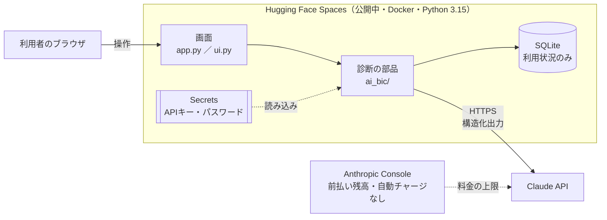
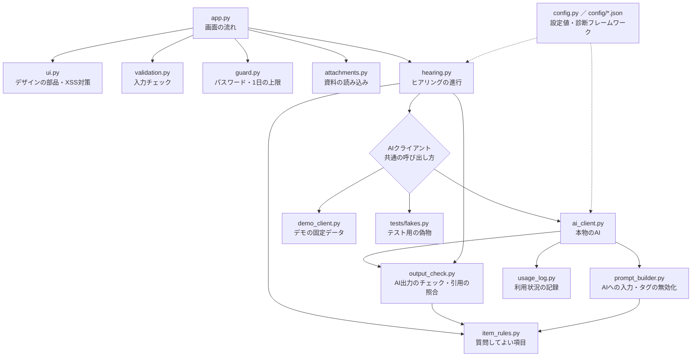
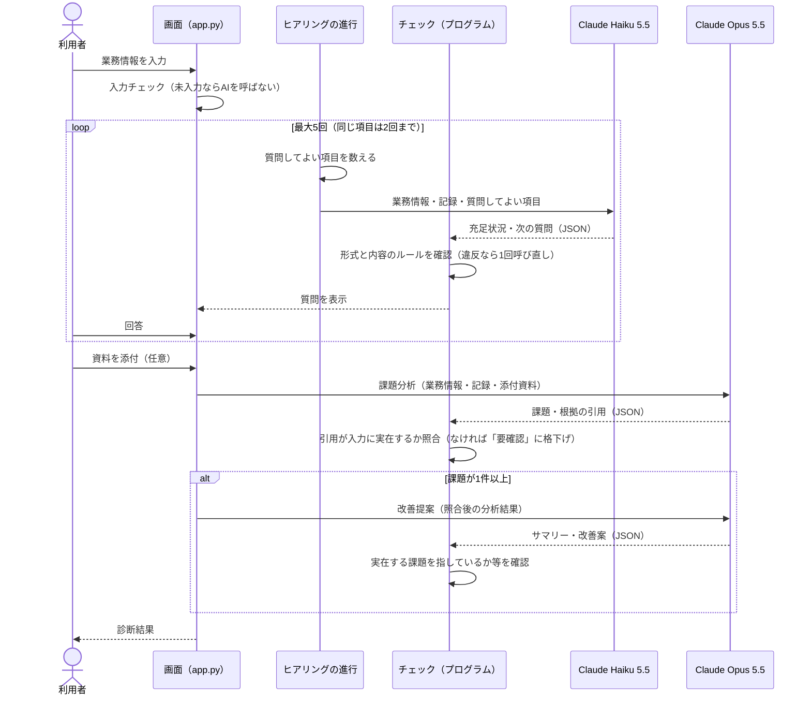
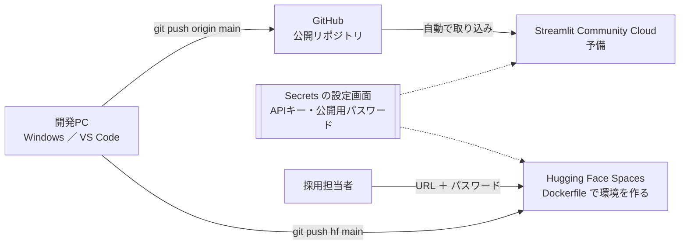
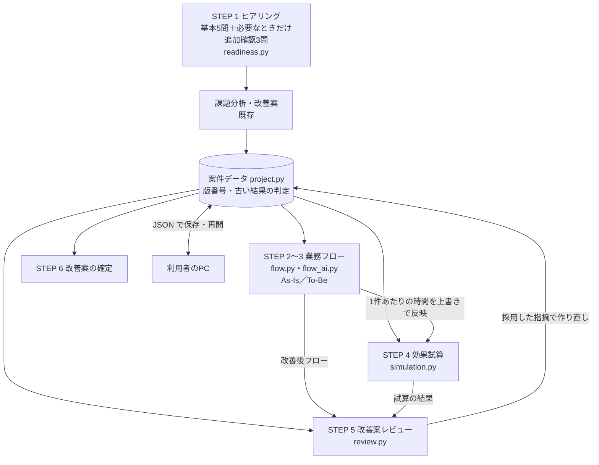

# 07 システム構成図：AI-BIC

| 項目 | 内容 |
|---|---|
| 文書バージョン | 1.2 |
| 作成日 | 2026-11-01 |
| 関連文書 | [03_基本設計書.md](03_基本設計書.md)（0.3）、[04_詳細設計書.md](04_詳細設計書.md)（0.10） |

実装が完了した時点の構成を、5つの図で示す。

---

## 1. 全体の構成

| 要素 | 役割 | 保存するもの |
|---|---|---|
| 利用者のブラウザ | 画面の表示と入力 | なし |
| 画面（app.py・ui.py） | 段階の切り替え、表示、入力の受け取り | 診断中の内容（セッションの中だけ。タブを閉じると消える） |
| 診断の部品（ai_bic/） | ヒアリングの進行、AIの呼び出しと出力のチェック、利用制限 | なし |
| SQLite | 利用状況の記録 | 日時・呼び出し種別・モデル・トークン数・成否のみ（**業務内容は保存しない**） |
| Secrets | APIキーとアクセス用パスワード | ソースコードとは別に管理（Gitに含めない） |
| Claude API | 質問の作成（Haiku 5.5）、課題分析・改善提案（Opus 5.5） | ― |
| Anthropic Console | 前払い残高が料金の確実な上限 | ― |

## 2. モジュールの関係

**ポイント：** hearing.py は、相手が本物のAI・デモ・テスト用の偽物のどれかを知らない。同じ3つの関数（質問する・分析する・提案する）で呼ぶため、テストは料金ゼロで、デモはAPIキーなしで動く。

## 3. 1回の診断の流れ

## 4. データの流れ（何がどこに行くか）

| データ | Claude API に送る | SQLiteに保存 | 画面のセッション |
|---|---|---|---|
| 業務情報・ヒアリングの回答 | ○（タグで囲み、`<` `>` を全角にして送る） | ×（列がないので保存できない） | ○（タブを閉じると消える） |
| 添付ファイルの内容 | ○（課題分析のときだけ） | × | ○ |
| AIの回答（質問・課題・改善案） | ― | × | ○（表示時はすべてエスケープ） |
| トークン数・成否・エラーの種類 | ― | ○ | ― |
| APIキー | ○（認証のため） | × | ×（Secretsから読むだけ） |

## 5. 公開時の構成（2026-11-04 移行：https://yukon2051-ai-bic.hf.space/）

| 項目 | 方針 |
|---|---|
| 公開先 | Hugging Face Spaces（無料の CPU basic）。2026-11-01〜11-03 は Streamlit Community Cloud で公開しており、現在は予備として残している |
| 移行した理由 | Streamlit Community Cloud はアクセスがないと約12時間で休止し、開いた人が「起こす」ボタンを押す必要がある。採用担当者が「動かない」と判断するおそれがあった。Hugging Face Spaces は休止までが48時間で、開くだけで自動で起動する（**休止しなくなるわけではない**） |
| 反映のしかた | GitHub と Hugging Face は別々の送り先。**更新するときは `git push origin main` と `git push hf main` の両方を行う** |
| APIキー | GitHubには含めない（.gitignore で除外を確認済み）。Hugging Face Spaces の Secrets に設定し、アプリは環境変数として読む（予備の Streamlit Community Cloud にも設定済み） |
| パスワード | ローカル開発用とは別のものを設定し、職務経歴書などで採用担当者に伝える（要件定義 Q3） |
| 料金 | 1日20回の上限（アプリ）＋ 前払い残高・自動チャージなし（Anthropic Console）の二重の対策 |
| 利用状況の記録 | Hugging Face Spaces でも、休止・再起動・更新のたびにファイルが初期化されるため、記録は参考扱い。確実な上限は前払い残高 |
| ファイル添付 | Hugging Face Spaces はアプリを別ページの中に埋め込んで表示するため、Streamlit のXSRF保護が添付を拒否した。Dockerfile の起動コマンドでだけ保護を無効にしている（AI診断はパスワードで守られ、添付ファイルは保存しないため、影響は小さいと判断） |

## 6. AI-BIC 2.0 で追加した部品と処理の流れ（1.2で追加）

診断のあと、結果画面で STEP 2〜6 を進める。改善案・業務フロー・試算・レビューは「案件」データ（project.py）にまとめ、
それぞれに版番号を持たせて、元の結果が変わったら「再作成／再計算／再レビューが必要」と表示する。

| 部品 | 役割 | AIを使うか |
|---|---|---|
| readiness.py | 3機能に必要な情報（業務フロー：作業内容／試算：作業時間・頻度／レビュー：問題点・制約）がそろっているかを、対応表で判定する | 使わない |
| simulation.py | 試算の計算式・3シナリオ・改善案の比較・値の出どころ | 使わない |
| flow.py | 工程と接続のデータ・編集・時間の合計（分岐で二重に数えない）・図の記述 | 使わない |
| flow_ai.py | 業務フローのAIの出力の形の確認と、利用者の発言との照合（ヒアリングの時間・件数、根拠のない工程は要確認） | 結果を確かめる側 |
| review.py | プログラムの検証・総合判定の上書き・根拠の照合・採用した指摘での作り直し | 結果を確かめる側 |
| progress.py | STEP 1〜6 の状態と次にすること | 使わない |
| views/ | 画面（試算・業務フロー・業務フロー図の表示部品・レビュー・進み具合） | ― |

| AIの呼び出し | モデル | 上限（1案件） | 費用（実測） |
|---|---|---|---|
| 業務フロー（As-Is と改善案ごとの To-Be を1回で） | Claude Opus 5.5 | 1回 | 約34.5〜37.8円 |
| 改善案レビュー | Claude Opus 5.5（改善案とは別の指示文） | 3回 | 約16.8〜17.2円 |
| 改善案の作り直し | Claude Opus 5.5 | 2回 | 未計測（約15〜30円の想定） |
| 追加確認の質問 | Claude Haiku 5.5 | 3問 | 未計測（1問約0.1円の想定） |

業務フロー図は、ブラウザの中で Graphviz（viz.js 3.29.0）を動かして描く（ズーム・パン・工程のクリックで詳細）。画像（PNG）の出力は、公開環境の Docker に入れた Graphviz で行う。

## 7. 変更履歴

| 版 | 日付 | 内容 |
|---|---|---|
| 1.0 | 2026-11-01 | 初版作成 |
| 1.1 | 2026-11-04 | 公開先を Hugging Face Spaces に移行（全体の構成、公開時の構成を更新） |
| 1.2 | 2026-11-09 | AI-BIC 2.0 で追加した部品と処理の流れ、AIの呼び出しの上限と実測の費用を追加 |
